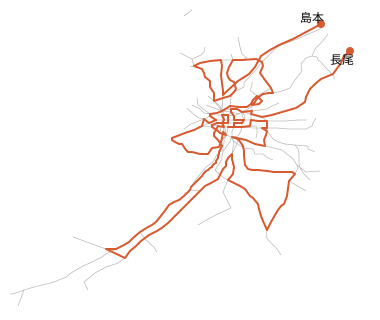

# 計測と照合の記録

## 環境と計測方法

- Linux x86_64、Intel Xeon 2.10GHz × 2コア、GCC 13.3（`-O3`、静的リンク）
- 時間は、プロセスの起動から終了までの実時間です。特に断りのない限り3回または5回の中央値で、規模別の表は「各規模3パターンの最悪値」です。
- 入力は、Python 試作の生成器（鉄道網に似た形・格子・小さいループの連なり（サボテン型）・密集）で作りました。生成器の詳細は Python 試作の `bench/gen.py` にあります。

| 種類 | 作り方 |
| --- | --- |
| 鉄道網に似た形（rail） | 平面上の点の最小全域木＋近い点どうしの追加路線＋行き止まりの支線 |
| 格子（grid） | r×c の格子。辺の長さは1〜10のランダム |
| 細長い格子（strip） | 3〜8列の長い格子 |
| サボテン型（cactus） | 3〜7駅の小さいループを駅でつないだもの（ときどき弦あり） |
| 密集（dense） | 駅どうしが確率 p（既定0.5）で直結 |

## 再現方法

```
python3 bench/bench.py ./longest bench/results/bench.jsonl              # 標準の21入力
python3 bench/sweep.py ./longest bench/results/sweep.jsonl rail 30      # 規模別（rail grid strip dense cactus dens30）
```

このファイルの「案ごとの対照実験」は、案を切り替えるスイッチがあった当時のコードで測りました。整理後のコードではそのスイッチを削除しているので、再現には `longest_cpp_experiments.zip` のコードを使います。

## データの一覧

| ファイル | 中身 |
| --- | --- |
| `bench/instances/` | 標準の21入力 |
| `bench/data/hard/` | 規模別計測で時間切れした入力（フロンティアDP導入前） |
| `bench/data/tune/` | 格子・密集の調整用入力（格子8×9〜14×14、密集16〜60駅など） |
| `bench/data/normal/` | 普段の入力の計測用（鉄道網300〜10,000駅、サボテン型3,000〜10万駅、密集ブロックの連なり） |
| `bench/results/bench_v1.jsonl` | 標準21入力の計測（C++ 移植直後） |
| `bench/results/ideas_t1.jsonl`, `combos_t1.jsonl`, `combos_t2.jsonl` | 7つの案の対照実験（1案ずつ／組み合わせ、1・2スレッド） |
| `bench/results/sweep_v1.jsonl` | 規模別計測：フロンティアDP導入前 |
| `bench/results/sweep_v2_fdp.jsonl` | 規模別計測：フロンティアDP導入後 |
| `bench/results/sweep_v3.jsonl` | 規模別計測：格子の枝刈り・密集のラグランジュ分岐の後 |
| `bench/results/sweep_v4.jsonl` | 規模別計測：プロファイルに基づく改良の後（最終） |
| `bench/results/ab_normal.jsonl` | 普段の入力向け7パーツの対照実験 |
| `bench/data/hardset/`（`bench/gen_hard.py` で生成） | 難問セット45入力：格子14×14〜20×20、密集100〜200駅、各駅3本・4本のランダム正則グラフと平均5本のランダムグラフ（50〜200駅） |
| `bench/results/hardset_v0.jsonl` / `hardset_v1.jsonl` | 難問セット：LPを広げる前／後（制限20秒） |
| `bench/results/sweep_v6.jsonl` | 規模別計測：LPを広げた後 |
| `bench/results/hardset_v2.jsonl` / `sweep_v7.jsonl` | 難問セット・規模別計測：改訂単体法の後 |
| `bench/results/hardset_v3.jsonl` / `sweep_v8.jsonl` | 難問セット・規模別計測（密集・格子）：ブロッサム不等式の後 |
| `bench/results/sweep_v5.jsonl` | 規模別計測：このプログラム専用の最適化（下の12節）の後 |
| `bench/results/matrix_v1.jsonl` / `matrix_v2.jsonl` | 規模・密度・構造の組み合わせ（`bench/matrix.py`）：最良優先の前／後 |
| `bench/results/hardset_v4.jsonl` | 難問セット：再現性の対策と最良優先の後（制限20秒） |
| `bench/results/lp_order_screen.jsonl` / `lp_order_ties.jsonl` | LPの探索順の対照実験（67入力／同点の決め方を変えた18入力） |
| `bench/results/determinism_ref.json` | 探索の道筋の基準（Linux・GCC、`bench/determinism.py`） |
| `bench/results/stab_ties.jsonl` / `stab_screen.jsonl` | 安定化4案の対照実験（同点の決め方を変えた18入力×3通り／67入力） |
| `bench/results/hardset_v5.jsonl` | 難問セット：並列レースの後（制限20秒） |
| `bench/data/real/` | 実在の鉄道網：47都道府県・地方ブロック・全国（`bench/gen_osaka.py` と同じ作り方） |
| `bench/results/real_prefectures.jsonl` / `contract_screen.jsonl` | 鎖の縮約の対照実験（実データ53入力／難問・組み合わせ67入力） |
| `bench/results/hardset_v6.jsonl` | 難問セット：鎖の縮約の後（制限20秒） |

## 1. 最終版の規模別の時間（`sweep_v4.jsonl`）

各規模3パターンの最悪値（秒）です。「TO」は30秒で終わらなかったことを、「—」はその版では測っていないことを表します。

| 入力 | 駅数 | v1（導入前） | v3 | v4（最終） |
| --- | --- | --- | --- | --- |
| rail | 1,000 | TO | 0.033 | 0.030 |
| rail | 3,000 | TO | 0.055 | 0.049 |
| rail | 5,000 | TO | 0.099 | 0.064 |
| cactus | 100,000 | 0.85 | 0.85 | 0.32 |
| grid 10×10 | 100 | TO | 0.076 | 0.075 |
| grid 11×11 | 121 | — | 0.23 | 0.22 |
| grid 13×13 | 169 | — | 2.6 | 2.2 |
| grid 14×14 | 196 | — | TO | TO |
| strip 3×100 / 8×100 | 300 / 800 | TO / — | 0.004 / 5.7 | 0.004 / 5.9 |
| dense | 48 | 14.5 | 1.26 | 0.23 |
| dense | 52 | — | 27.0 | 0.21 |
| dense | 60 | — | 4.9 | 0.46 |
| dense | 80 | — | — | 0.91 |

## 2. C++ 移植直後（`bench_v1.jsonl`）

| 入力 | 駅数 | 1スレッド | 2スレッド |
| --- | --- | --- | --- |
| rail1000 | 1,000 | 0.042秒 | 0.054秒 |
| rail3000 | 3,000 | 0.30秒 | 0.25秒 |
| cactus3000 | 3,000 | 0.031秒 | 0.030秒 |
| grid8x8 | 64 | 0.069秒 | 0.058秒 |
| dense26 | 26 | 0.035秒 | 0.037秒 |
| dense36 | 36 | 0.18秒 | 0.14秒 |

rail3000 は、端のおまけ方式にする前は4.4秒でした。

## 3. 7つの案（`ideas_t1.jsonl`、1スレッド、21入力）

| 案 | dense26 | grid8x8 | dense36 | 21入力の合計 | 判定 |
| --- | --- | --- | --- | --- | --- |
| なし（基準） | 1.35秒 | 1.52秒 | 0.39秒 | 3.80秒 | — |
| A1 答え探しの予行 | 1.31秒 | 0.18秒 | 0.38秒 | 2.39秒 | 単独では効くが A2・B3 と重なる → 不採用 |
| A2 始点の順番 | 1.39秒 | 0.090秒 | 0.39秒 | 2.42秒 | 採用 |
| A3 森の連結＋回転の連鎖 | 1.33秒 | 1.44秒 | 0.40秒 | 3.68秒 | 不採用 |
| B1 ループ専用の乗数 | 0.021秒 | 1.36秒 | 0.099秒 | 2.05秒 | 採用 |
| B2 ループの向きを1つに | 0.89秒 | 1.51秒 | TO | — | 不採用 |
| B3 番号の付け直し（重い駅から） | 1.83秒 | 1.54秒 | 0.31秒 | 4.23秒 | 不採用 |
| B3 番号の付け直し（軽い駅から） | 0.71秒 | 0.062秒 | 0.35秒 | 1.65秒 | 採用 |
| B4 ループ探索の分担を細かく | 1.55秒 | 1.41秒 | 1.32秒 | 4.88秒 | 不採用 |
| A2＋B1＋B3 | 0.023秒 | 0.074秒 | 0.14秒 | 0.78秒 | 既定（約4.9倍） |

## 4. 起動まわり

| 変更 | 例題の時間 |
| --- | --- |
| 変更前 | 2.39ミリ秒 |
| 静的リンク＋小さいグラフは1スレッド | 1.30ミリ秒 |
| 参考：何もしないプログラム | 1.09ミリ秒 |

2スレッドで速くなったのは、最大ブロックが49駅以上の入力だけでした。そこで、境目を40駅にしました。

## 5. フロンティアDP（`sweep_v1` → `sweep_v2_fdp`）

時間切れしていたブロックの性質を調べると、木幅（グラフの細さを表す数）はどれも4以下でした。

| 入力 | 一番大きいブロック | 独立したループの数 | 木幅 |
| --- | --- | --- | --- |
| 格子 3×100 | 300駅 | 198 | 3 |
| 鉄道網 1,000駅（時間切れした例） | 266駅 | 107 | 4 |
| 鉄道網 2,000駅（時間切れした例） | 397駅 | 140 | 4 |
| 参考：密集36駅 | 36駅 | 284 | 25 |

状態の数（1ステップの最大）は、幅だけでほぼ決まります。幅4で26、幅5で101、幅7で1,564、幅9で約2万5千、幅11で約31万でした。

| 入力 | 導入前 | 導入後 |
| --- | --- | --- |
| 鉄道網 1,000 / 3,000 / 5,000駅 | 時間切れ | 0.023 / 0.062 / 0.10秒 |
| 格子 3×100 / 4×100 | 時間切れ | 0.003 / 0.006秒 |
| 格子 9×10 / 10×10 | 3.1秒 / 時間切れ | 0.47 / 2.1秒 |
| 格子 8×8 | 0.051秒 | 0.070秒（この幅では分枝限定法が速い回もある） |

使う条件を決めた計測：

- 密集18駅は、幅が小さくても1ステップ740万状態になり、20秒かかりました。そこで、密集したブロックでは使わない条件にしました。
- 正方に近い格子は幅9で一部負けますが、時間が入力によってぶれないことを優先しました。

## 6. 枝刈りとビーム（格子）

| ビームの幅 | 格子10×10 | 11×11 | 12×12 | 13×13 |
| --- | --- | --- | --- | --- |
| 200 | 0.033秒 | 0.26秒 | 2.3秒 | 3.8秒 |
| 500 | 0.041秒 | 0.13秒 | 1.6秒 | 2.4秒 |
| **1,000（採用）** | 0.059秒 | 0.14秒 | 1.2秒 | 2.4秒 |
| 20,000 | 0.54秒 | 0.87秒 | 1.8秒 | 3.9秒 |

格子11×11は、枝刈りなしだと1ステップ125万状態・15秒でした。枝刈りとビームを入れると、1ステップ1.1万状態・0.23秒になりました。

## 7. ラグランジュ分岐（密集）

| 構成 | dense48（seed 1） |
| --- | --- |
| 導入前 | 15秒（ループの証明に14秒） |
| 最良解を最初から与えた場合（参考） | 11.5秒 |
| 始点ごとに乗数を調整し直す | 6秒（48始点中44を探索せずに飛ばす） |
| ＋最初の数歩で分岐（試し探索2,000ノード、最大8歩） | 1.3秒 |

## 8. 時間の内訳（callgrind、命令数の割合）

| 入力 | 主な内訳 |
| --- | --- |
| 鉄道網 3,000駅 | 小ブロックのビットDP 45%、フロンティアDP 12%、全体の初期解 13%、入力の読み込み 8% |
| サボテン型 10万駅 | 小ブロックのビットDP 46%、入力の読み込み 19%、部分グラフのコピー 8% |
| 密集40駅 | 経路探索の分枝限定法 89% |
| 格子11×11 | フロンティアDPの状態処理 67% |

## 9. 普段の入力向けの7パーツ（`ab_normal.jsonl`、5回の中央値、ミリ秒）

| 入力 | 全部なし | 全部あり |
| --- | --- | --- |
| サボテン型 10万駅 | 620 | 154 |
| サボテン型 3万駅 | 164 | 47 |
| 鉄道網 300駅 | 10.9 | 1.8 |
| 鉄道網 1,000駅 | 10.2 | 3.9 |
| 鉄道網 5,000駅 | 54.7 | 25.2 |
| 鉄道網 10,000駅 | 92.9 | 46.5 |
| 鉄道網 3,000駅（大ブロックあり） | 48.7 | 44.7 |

7つとも、全部入りから1つ抜くと遅くなりました。たとえば、ブロック処理の配列化と答えの最後の組み立てを抜くと、サボテン型10万駅で 154 → 534 ミリ秒になります。

- **全経路の列挙**：密集したブロックに使うと逆効果でした（89 → 196 ミリ秒）。そこで「辺が駅の数＋8以下」の条件を付けました。
- **鎖の圧縮**：大きいブロックで消せる辺の割合を数えたところ、18〜21%でした。上限でも全体の1割程度なので実装しませんでした。

## 10. 格子：ランクベース法

| 入力 | ランクベース法なし | 早めに使う（11×11は常に、それ以外は2万状態から） | 50万状態を超えたら使う（採用） |
| --- | --- | --- | --- |
| 格子11×11 | 0.23秒 | 0.38秒 | 0.23秒 |
| 格子13×13 | 2.5秒 | 3.4秒 | 2.6秒 |
| 格子14×14（seed 1） | 時間切れ | 36秒 | 31秒 |

## 11. 密集：LP分枝カット法と経路のラグランジュ分岐

Python + HiGHS で試作して、上界の締まり具合を確かめました。

| 入力 | ループの上界（ラグランジュ） | ループの上界（LP） | 最適値 | 証明に必要なノード数（LP） |
| --- | --- | --- | --- | --- |
| dense40（seed 1） | 353.79 | 352.97 | 352.95 | — |
| dense48（seed 1） | 438.30 | 437.50 | 437.30 | 17 |
| dense52（seed 2） | 479.71 | 479.50 | 479.38 | 7 |

C++ 実装の効果：

| 構成 | 密集24入力の合計 | 最悪 |
| --- | --- | --- |
| LPなし | 13.6秒 | 2.7秒（dense60） |
| LPあり（採用） | 3.4秒 | 0.41秒 |

経路のラグランジュ分岐は、LPなしで比べると密集12入力（44〜60駅）の合計が36.7秒 → 9.8秒、dense52 の最悪が24秒 → 2.0秒でした。採用し、LPが証明できないときの予備にしています。

ループの向きの重複除去は、dense56 で 0.82 → 2.88秒と悪化する入力があり、合計でも悪化したので不採用にしました。

## 12. このプログラム専用の最適化（`bench/ab.py`）

「汎用のコンパイラや実行環境が知らないこのプログラムの性質を、こちらで使う」という視点で、6つの案を試しました。`bench/ab.py` で構成を交互に実行し、例題41回、普段の入力7回、標準21入力5回、難しい入力3回の中央値を取っています。同じ実行ファイル同士を比べた差（ばらつき）は約4%でした。

| 案 | 中身 | 結果 | 判定 |
| --- | --- | --- | --- |
| 専用のメモリ確保 | 240バイト以下の確保を、スレッドごとの空きリストから取る（`src/alloc.hpp`） | 普段の入力の合計 375 → 331 ms（−12%）、標準21入力 177 → 162 ms（−8%）。メモリはサボテン型10万駅で 26 → 30 MB | 採用 |
| 終了時の後片付けを省く | 出力したら解放せずに終了 | 普段の入力 333 → 331 ms、例題も変化なし（ばらつきの範囲） | 不採用 |
| フロンティアDPを幅ごとに作り分け | 幅12以下は状態を64ビット1語で持つ | 11回の中央値で、格子 7×7〜11×11 と鉄道網3,000駅が4〜11%速い | 採用 |
| 分枝限定法を駅数ごとに作り分け | 64駅以下は駅の集合を1語で持つ | 現在の既定構成では、計測用の全入力で分枝限定法が1,000ノード以上動く入力がなかった（フロンティアDPとLPに置き換わったため）。効く先がない | 不採用（未実装） |
| 距離の整数化 | 全距離が小数6桁以内なら10^d 倍して整数で計算し、「より良い」を「0.5より大きく上回る」で判定 | 速さはほぼ同じ（難しい入力で −5%）。**正しさの不具合を1つ解消**（下） | 採用 |
| PGO（実行記録による再最適化） | 訓練用の入力で記録を取り、それを使って再コンパイル | 普段の入力 −4%、標準 −3%、難しい入力 −3%。2段階のビルドと訓練データが必要になる | 不採用（効果がビルドの複雑さに見合わない） |
| CPUごとの関数の作り分け | 状態処理と上界計算をAVX2版と標準版の2つ作り、起動時に選ぶ | 効果なし（難しい入力の合計 3,856 → 3,943 ms）。`-march=native`（そのCPU専用）でも効果なし | 不採用 |
| 起動の固定費 | iostream をやめ、入力を大きな読み込みでまとめて取る | 例題 1.15 → 1.15 ms で変化なし。固定費はOSの起動そのもの | 不採用 |

### 距離の整数化で見つかった不具合

それまでの版は、浮動小数点の誤差を吸収するために、比較に相対的な許容誤差（値の10億分の1）を使っていました。そのため、合計が非常に大きいと、0.01の差が「同じ」と扱われることがありました。

| 入力 | 正しい答え | 整数化前の出力 |
| --- | --- | --- |
| `1, 2, 1000000000.00` と `3, 4, 1000000000.01` | 3 → 4（1,000,000,000.01） | 1 → 2（0.01短い） |

`tests/check_precision.py`（有理数で厳密に計算する総当たりと比べるテスト）では、10億前後の距離で差が0.01の入力が98回中24回、最大0.31短い経路を出していました。整数化後は、小数の桁数がばらばらな入力、指数表記（浮動小数点のまま扱う）、小数7桁（同）を含めて352回全て一致しています。

### この最適化の後（`sweep_v5.jsonl`、各規模3パターンの最悪値、秒）

| 入力 | 前 | 後 |
| --- | --- | --- |
| 鉄道網 1,000 / 3,000 / 5,000駅 | 0.030 / 0.049 / 0.064 | 0.023 / 0.035 / 0.055 |
| サボテン型 10万駅 | 0.32 | 0.27 |
| 格子 10×10 / 11×11 / 13×13 | 0.075 / 0.22 / 2.2 | 0.049 / 0.15 / 2.0 |
| 細長い格子 8×100 | 5.9 | 4.3 |
| 密集 48 / 60 / 80駅 | 0.23 / 0.46 / 0.91 | 0.14 / 0.28 / 0.79 |

規模別計測で両方の版が解けた235入力の答えは、全て一致しました。

## 13. 難問セット（`hardset_v0` → `hardset_v1`、制限20秒）

| 種類 | 解けた数（前→後） | 後の最悪時間 |
| --- | --- | --- |
| 格子 14×14 / 16×16 / 20×20 | 1/9 → 1/9 | 14×14 の残り2つは33〜38秒で解ける。16×16 以上は未解決 |
| 密集 100 / 150 / 200駅 | 3/9 → 9/9 | 4.5秒 |
| 各駅3本のランダム（50〜200駅） | 5/9 → 9/9 | 16.5秒（200駅の1つ） |
| 各駅4本のランダム（同） | 5/9 → 9/9 | 4.5秒 |
| 平均5本のランダム（同） | 3/9 → 8/9 | 3.5秒（残る1つは30〜35秒） |
| 合計 | 17/45 → 36/45 | |

弱点は中くらいの密度でした。細くないのでフロンティアDPが使えず、LPの条件（密集かつ成分全体が1ブロック）からも外れて、分枝限定法だけに頼っていました。

### パーツごとの結果

| パーツ | 結果 | 判定 |
| --- | --- | --- |
| LPを、フロンティアDPが受け持たない全ブロックに広げる（他とつながったブロックでも、端のおまけ・端の固定つきで使う） | 平均5本100駅：全て時間切れ → 0.04〜0.9秒。各駅3本200駅：全て時間切れ → 2つが1.5〜6.5秒 | 採用 |
| 制約の上限600本 → 余裕のある制約を表から取り除く | 証明を諦めていた原因が、制約の上限だった（各駅3本200駅：上限600で諦める → 取り除き方式で10.5秒） | 採用 |
| 単体法の高速化（ピボット行の0を飛ばす、基底変数の値を1回だけ計算） | 10.5 → 6.4秒、1.5 → 0.86秒 | 採用 |
| LPを使うときは初期解のビームサーチを省く | 密集100駅 1.6 → 0.056秒、150駅 8.3 → 0.76秒、標準21入力の合計 176 → 89 ミリ秒 | 採用 |
| 違反の大きい制約から1回20本まで | 遅い8入力の合計 81 → 68秒（50本でも同じ） | 採用 |
| 格子の白黒の釣り合いを制約に加える | 格子14×14で 18.1 → 16.4、2.0 → 1.9、35.3 → 36.8秒。LPの解は元から釣り合っていて効かない | 不採用 |
| 根での被約費用による辺の固定 | 効果なし | 不採用 |
| 格子でフロンティアDPを早めに諦めてLPへ | 14×14：速くなる入力（37 → 20秒）と遅くなる入力（33 → 38秒）が混在 | 不採用 |
| 参考：格子でLPとフロンティアDPのどちらが速いか | 13×13：DP 2.2秒、LP 34.6秒。12×12：1.1秒、15.3秒 | DPを先に使う順番のまま |

計測の途中で、LPが時間制限を確かめていない不具合を見つけて直しました（制限20秒で43秒かかっていた）。

残った難問（格子16×16以上、平均5本200駅の1つ）では、時間のほとんどが単体法のピボットでした。表は約900行×1,700列あり、1回のピボットに約1ミリ秒かかります。これより速くするには、表を密に持たない単体法（LU分解を使う改訂単体法）が必要です。

規模別計測（`sweep_v6`）では、密集48 / 60 / 80駅が 0.14 / 0.28 / 0.79秒 → 0.029 / 0.026 / 0.047秒になりました。その他は変化なし（ばらつきの範囲）で、両方の版が解けた235入力の答えは全て一致しました。

## 14. 改訂単体法（`src/revised.hpp`）

**測定**（callgrind、各駅3本200駅）：LP分枝カット法の時間の内訳は、表のピボット更新 70%、基底変数の値の計算 19%、制約探し（最小カット）8% でした。単体法が約9割です。

**実装**：表 B^-1 A を持たず、元の疎な行列と、基底の逆行列の積形式（基底の入れ替え1回ごとに1本の列ベクトル、64回ごとに作り直し）を持ちます。1回の反復は、B の方程式2つ（FTRAN / BTRAN）と、列ごとの疎な内積だけです。上下限付きの主・双対単体法で、表方式と同じ入口（`--x lp_revised=0` で表方式）にしています。

実装中に見つけた不具合（照合とアドレスサニタイザーで検出し、修正済み）：

- 制約を取り除いた後、基底変数の値を行番号の付け替えに合わせていなかった
- 積形式の逆行列が古い行番号を指したまま双対変数を計算していた（範囲外アクセス）

正しさは、表方式のときと同じく、安全な上界・検算つきの「解なし」・元のグラフでの解の測り直しで守っています。

| 入力（難問セットのLP対象27入力） | 表方式 | 改訂単体法 |
| --- | --- | --- |
| 合計（制限60秒） | 86.1秒 | 15.4秒 |
| 平均5本200駅（seed 1） | 35.1秒 | 1.9秒 |
| 各駅3本200駅（seed 3） | 16.7秒 | 1.7秒 |
| 密集200駅（seed 3） | 4.7秒 | 1.3秒 |

**格子での順番の見直し**：改訂単体法なら、広い格子ではLPの方がフロンティアDPより速くなりました。そこで、フロンティアの幅が14を超える（格子14×14以上の）ブロックは、LPを先に使うようにしました。境目は計測で決めています。

- 13×13：DP 2.2秒、LP 5.1秒（幅14まではDPのまま）
- 14×14：DP 2.8〜35秒、LP 0.2〜2.8秒

| 難問セット（制限20秒） | 前 | 後 |
| --- | --- | --- |
| 解けた数 | 36/45 | **41/45** |
| 格子 14×14 | 1/3 | 3/3（最悪2.8秒） |
| 格子 16×16 | 0/3 | 2/3（2.3〜2.7秒、残る1つは27秒） |
| 格子 20×20 | 0/3 | 0/3 |
| 密集・ランダムグラフ（36入力） | 35/36 | 36/36（最悪2.3秒） |

規模別計測（`sweep_v7`）では、格子14×14が初めて全部解けました（最悪2.7秒）。その他は変化なし（ばらつきの範囲）で、両方の版が解けた236入力の答えは全て一致しました。

## 15. 格子の残り：ブロッサム不等式・強分岐・DPとLPの組み合わせ

**原因の測定**（Python + HiGHS で最初のLPを解いて調べた）：格子16×16（seed 1）のLPは、ほぼ全駅を使い切っていて（256駅中253）、迷っているのは「どの辺を通るか」でした。0と1の中間の値を取る辺が98本あり、その多くは4駅の小さな四角に固まっていました。四角の回り方を、2通りに半分ずつ配った形です。

| 案 | 中身 | 結果（LPを使う難問33入力、制限60秒） | 判定 |
| --- | --- | --- | --- |
| ブロッサム不等式 | 頂点の集合 H と、H から出る奇数本の辺 T について x(E(H)) + x(T) − Σ_H y ≤ (\|T\|−1)/2。H の次数の式の半分と T の上限の半分の和を切り捨てた形（チュヴァタル・ゴモリーの切除平面）なので、H と T の選び方によらず常に正しい。H は中間の値の辺がつながった塊、T は H から出る値が1/2を超える辺 | 合計 42.8 → 32.6秒（−24%）。格子16×16（seed 1）8.9 → 6.9秒、各駅3本200駅 1.9 → 0.7秒 | 採用 |
| くし形不等式（歯が辺より大きいもの） | — | 駅を使わない選択肢がある今の問題で正しい形を確かめる手間が大きく、ブロッサム（歯が辺1本のくし形）で止めた | 未実装 |
| 強分岐 | 中間の値の変数を8〜16個、0と1に固定して50〜100反復だけ解き、上界が一番下がるもので分岐 | ノード数は減る（格子16×16：165 → 71）が、時間は増える（8.2 → 14.7秒）。各駅3本200駅は 2.1 → 9.5秒、候補16個では時間切れ | 不採用 |
| DPとLPの組み合わせ（常に） | LPの前に、状態を1万に絞ったフロンティアDPで良い解を作る | 格子16×16（seed 1）28.8 → 9.6秒だが、ランダムなグラフでは毎回0.1〜1秒の上乗せ | 不採用 |
| DPとLPの組み合わせ（LPが100ノードで終わらないときだけ） | 同上を、LPが手こずったときだけ使う | 格子16×16（seed 1）15.2 → 10.9秒、一方で14×14 2.6 → 4.9秒、16×16（seed 3）2.8 → 6.5秒。合計で変化なし | 不採用 |

試した構成の幅で比べると、DPの解をLPに渡す方法の効き方は入力ごとに大きくぶれ、合計では得になりませんでした。

| 難問セット（制限20秒） | 前 | 後 |
| --- | --- | --- |
| 解けた数 | 41/45 | **42/45**（格子16×16 seed 1 が15秒） |
| 前の版でも解けた41入力の合計時間 | 23.5秒 | 17.3秒 |
| 格子 20×20 | 0/3 | 0/3（180秒でも未解決） |

**鉄道網の規模・構造を変えたときの効き方**（`prototype_python/bench/gen.py` の `railway(n, seed, extra_ratio)`、駅数 300/1000/3000 × 追加の路線の割合 0.25/0.6/1.0 × seed 2つの18入力、制限60秒、ブロッサムなし → あり）：

| 構造 | 結果 | 読み方 |
| --- | --- | --- |
| 普通の鉄道網（追加 0.25・0.6） | 12入力すべて誤差の範囲（0.01〜0.4秒、最大は3000駅 seed 2 の 3.85 → 4.12秒） | ほとんどのブロックがフロンティアDPやbitDPで解け、LPがほぼ使われないので変化なし |
| 中心部が密な鉄道網（追加 1.0） | 1000駅 seed 1：時間切れ → 49.3秒。3000駅 seed 1：時間切れ → 1.8秒。3000駅 seed 2：両方時間切れ | 大きく密な塊がLPに回り、そこで効く |
| 合計（時間切れは60秒で数える） | 184.5 → 115.8秒 | 悪くなった入力はなし |

ブロッサム不等式はLPを使うブロックにだけ効きます。普通の鉄道網ではLPの出番がないので変化がなく、密な塊（中心部が密な鉄道網、中くらいの密度のグラフ、格子）があるときに効きます。

## 16. 照合（正しさ）

| 時期 | 内容 | 回数 | 不一致 |
| --- | --- | --- | --- |
| 7つの案 | 全スイッチとその組み合わせ × 総当たり・Python 試作 | 約41,000回 | 0 |
| フロンティアDP | DPを全ブロックに強制、わざと諦めさせる設定など | 約12,500回 | 0 |
| 枝刈り・ビーム・ラグランジュ分岐 | ビーム幅3などの極端な設定、分岐を限界まで深く | 約19,000回＋大きい入力18個 | 0 |
| プロファイル後の改良 | LPのノード上限2（必ず諦める）、ランクベース法を常に使う、列挙を必ず打ち切る、など | 約17,000回＋大きい入力30個 | 0 |
| 専用の最適化 | 上の照合（整数化・64ビット状態を切る設定を追加）＋有理数の総当たり（大きな値・桁数の混在・浮動小数点への切り替え） | 約6,700回＋大きい入力30個＋352回 | 0 |
| 難問への対策 | 照合（約4,550回）、精度テスト270回、大きい入力30個、難問セットで前の版が解けた17入力、新しく解けた18入力を別の設定（1スレッド・制約の加え方を変える・DPなし）で解き直し、うち2つは前の版の分枝限定法（300秒）とも一致 | 約4,800回＋65入力 | 0 |
| 改訂単体法 | 照合（約5,000回、表方式との比較を含む）、精度テスト272回、大きい入力30個、難問セットで前の版が解けた36入力、新しく解けた格子16×16の2つを表方式（27〜37秒）でも解いて一致、アドレスサニタイザーでの実行 | 約5,300回＋70入力 | 0 |
| ブロッサム不等式 | 照合（約5,200回、ブロッサムなし・制約1本ずつの設定を含む）、精度テスト270回、大きい入力30個、難問セット41入力が前の版と一致 | 約5,500回＋71入力 | 0 |
| 規模別計測 | 各版の答えどうし | 415入力＋235入力＋235入力＋236入力＋135入力 | 0 |

大きい入力の照合では、独立した方法と比べています。格子は枝刈りなしのフロンティアDP、密集は前の版の分枝限定法です。

## 17. 規模・密度・構造の組み合わせ（`bench/matrix.py`、`matrix_v1.jsonl`、制限60秒）

構造3種（小ループ：4〜8駅の輪を1駅でつないだ形／鉄道網型：平面上の点を近い順につないだ形／格子型：正方の格子）× 密度4段階（1駅あたりの路線数 1.2・1.5・2.0・3.0）× 規模5段階（30〜3000駅）× seed 2つ。値は遅い方の秒数。※は片方が時間切れ、×は両方時間切れ、—は小さい規模で両方時間切れだったので未計測。

| 小ループ | 30 | 100 | 300 | 1000 | 3000 |
| --- | --- | --- | --- | --- | --- |
| 1.2 | 0.00 | 0.01 | 0.01 | 0.00 | 0.01 |
| 1.5 | 0.00 | 0.00 | 0.01 | 0.01 | 0.02 |
| 2.0 | 0.00 | 0.01 | 0.01 | 0.01 | 0.03 |
| 3.0 | 0.01 | 0.01 | 0.03 | 0.02 | 0.08 |

| 鉄道網型 | 30 | 100 | 300 | 1000 | 3000 |
| --- | --- | --- | --- | --- | --- |
| 1.2 | 0.00 | 0.00 | 0.01 | 0.01 | 0.02 |
| 1.5 | 0.00 | 0.01 | 0.02 | 0.02 | 0.04 |
| 2.0 | 0.00 | 0.01 | 3.38 | × | — |
| 3.0 | 0.02 | 0.11 | 6.62 | × | — |

| 格子型 | 30 | 100 | 300 | 1000 | 3000 |
| --- | --- | --- | --- | --- | --- |
| 1.2 | 0.00 | 0.01 | 0.03 | 17 | × |
| 1.5 | 0.00 | 0.03 | 4.09※ | × | — |
| 2.0 | 0.00 | 0.10 | 19※ | × | — |
| 3.0 | 0.00 | 2.58 | 14※ | × | — |

時間切れの入力はすべて、一番大きいブロック（どの1駅を消しても切れない塊）が約300駅以上でした。鉄道網型2.0・1000駅は497〜616駅、格子型1.2・3000駅は1749〜1950駅です。全体の駅数ではなく、一番大きいブロックの大きさで決まります。特に400駅を超えるブロックはLPの対象外なので、手が止まります。

## 18. 再現性と探索順（`lp_order_*.jsonl`、`hardset_v4`、`matrix_v2`）

**環境による違い**：Windows（Visual Studio 2019）の実機では、照合は全部一致しましたが、一部の入力でLPのノード数が Linux と違いました（鉄道網型・密度2.0・300駅：55 → 701ノード、3.4 → 44秒）。標準ライブラリの乱数の分布・ハッシュ・同点の並べ替え順の違いが原因なので、自前の決まった処理に置き換えました（設計5.1節）。置き換えた後、次のビルドで23入力の統計（答え・ノード数・LPのノード数・DPの状態数）が基準と完全に一致しました。

| ビルド | 基準との違い |
| --- | --- |
| GCC 13・-O3（基準） | — |
| Clang 18・-O3 | 0/23 |
| GCC 13・-O2・動的リンク | 0/23 |

**探索順の対照実験**：同点の決め方を3通り変えた（`--x` の実験用スイッチで、計測後に削除）18入力、制限30秒。時間切れは30秒で数えます。

| 探索順 | 合計 | 時間切れ | 各入力の最悪時間の平均 | ぶれ（最悪÷最良の中央値） |
| --- | --- | --- | --- | --- |
| 深さ優先（前） | 595.6秒 | 9 | 14.2秒 | 1.79倍 |
| 最良優先 | 452.6秒 | 7 | 9.0秒 | 1.10倍 |
| 最良優先＋潜り込み（差が残りの差の半分以内） | 454.9秒 | 4 | 10.0秒 | 1.41倍 |
| **最良優先＋潜り込み（最良の上界から0.05%以内）** | **417.2秒** | 6 | **8.7秒** | 1.32倍 |
| （参考）LPの解から経路を組み立てる初期解を追加 | 合計は追加しない場合とほぼ同じ（392.7秒 対 391.6秒、67入力） | | | |

- 最適解の値を最初から渡す実験：鉄道網型・密度2.0・300駅（seed 2）は 431ノード・6秒 → 5〜7ノード・0.16秒でした（時間は「見つける」側）。格子（密度3.0・100駅、密度2.0・300駅）はノード数が変わりませんでした（時間は「証明する」側）。
- 67入力（難問セット＋組み合わせ計測の入力）では、最良優先＋潜り込みが深さ優先に比べて18入力で3割以上速く、3入力で3割以上遅くなりました（鉄道網型・密度3.0・300駅（seed 1）2.0 → 5.7秒、格子・密度3.0・100駅（seed 1）3.7 → 5.7秒、格子・密度2.0・300駅（seed 2）21.7 → 29.2秒）。

**採用後**

| 計測 | 前 | 後 |
| --- | --- | --- |
| 難問セット（制限20秒）：解けた数 | 42/45 | 42/45 |
| 同：両方で解けた42入力の合計 | 37.0秒 | 24.7秒 |
| 同：格子16×16（seed 1 / 2 / 3） | 16.8 / 3.3 / 3.0秒 | 8.1 / 1.1 / 4.5秒 |
| `ab.py` normal / std（合計ミリ秒） | 402.3 / 95.8 | 390.0 / 96.8 |
| `ab.py` hard（合計ミリ秒） | 3,777 | 3,918（格子13×13が+6%。フロンティアDPの状態数が同点の扱いの変化で 151,777 → 163,227） |

組み合わせ計測（制限60秒、2つの seed の遅い方の秒数、括弧は前）。変化があったセルだけ載せます。

| 構造・密度・駅数 | 後（前） |
| --- | --- |
| 鉄道網型・2.0・300 | 0.24（3.38） |
| 鉄道網型・3.0・300 | 5.98（6.62） |
| 格子・1.2・1000 | 15（17） |
| 格子・2.0・300 | 30（19※：片方は時間切れ → 両方解けた） |
| 格子・3.0・100 | 5.72（2.58） |
| 格子・3.0・300 | 2.80※（14※） |

照合：check.py 3,944回、check_fdp.py 6,000回（深さ優先・潜り込みなし・常に潜り込み・ノード上限3の設定を追加）、check_big.py 30入力、check_precision.py 352回、すべて不一致0。

## 19. 安定化の4案（`stab_ties.jsonl`、`stab_screen.jsonl`）

同点の決め方を3通り変えた18入力（制限30秒、時間切れは30秒で数える）と、67入力×1通り。答えはすべての設定で一致。

| 設定 | 18入力×3通り：合計 | 時間切れ | 最悪時間の平均 | ぶれ（最悪÷最良の中央値） | 67入力：合計 | 時間切れ |
| --- | --- | --- | --- | --- | --- | --- |
| 前（最良優先＋潜り込み） | 415.7秒 | 4 | 8.82秒 | 1.46 | 389.1秒 | 9 |
| 擬似コスト分岐 | 396.0 | 4 | 8.29 | 1.37 | 389.3 | 9 |
| **並列レース（採用）** | **378.1** | **2** | 7.97 | 1.35 | **369.2** | **8** |
| 再出発（100ノードから倍々） | 462.0 | 9 | 9.35 | 1.48 | — | — |
| 擬似コスト＋レース | 361.3 | 4 | 7.51 | 1.25 | 369.4 | 9 |
| 擬似コスト＋再出発 | 441.0 | 6 | 9.05 | 1.44 | — | — |
| くし形不等式 | — | — | — | — | 389.1 | 10（違反する制約0本） |

- 前の版より30%以上遅くなった入力：レースはなし。擬似コストは67入力中4つ（格子16×16 seed 1 8.3 → 13.1秒、鉄道網 3000駅・密 0.9 → 1.7秒など）、再出発は格子14×14・16×16で1.4倍。
- 30%以上速くなった入力：レースは格子16×16 seed 3（4.5 → 3.2秒）、格子・密度2.0・300駅 seed 2（29.8 → 21.3秒）、鉄道網型・密度3.0・300駅 seed 1（5.9 → 1.9秒）など。中心部が密な鉄道網1000駅は、レースだけが時間内（26.3秒）。
- レースで深さ優先側が勝った回数：難問セットでは `race_dfs_won` に出ます。

**採用後**（`hardset_v5`）：難問セット（制限20秒）は 42/45 のまま、両方で解けた42入力の合計は 25.1 → 24.5秒（格子16×16 seed 3 が 4.5 → 3.1秒）。`ab.py` の normal / std / hard は 413 / 100 / 4,331 → 410 / 100 / 4,270 ミリ秒。照合：check.py 3,944回、check_fdp.py 6,800回（レースを2スレッドで強制・ノード上限4・レースなしの設定を追加）、check_big.py 30入力、check_precision.py 352回、すべて不一致0。再現性チェック（1スレッド）23入力一致。

## 20. 実在の鉄道網：大阪府の全駅（`bench/data/real/osaka.txt`）

駅データ.jp の公開CSV（2018年）から、大阪府内の営業中の全駅で鉄道網を作りました（`bench/gen_osaka.py`）。乗り換えでつながる駅はひとつにまとめ、路線ごとに隣り合う駅を区間とし、距離は緯度経度からの直線距離（km）です。445駅・510区間・54路線、総延長 644.5km。

| 項目 | 値 |
| --- | --- |
| 時間 | 0.11秒（1スレッドでも2スレッドでも同じ） |
| 答え | 301.53km、241駅（島本 → … → 長尾） |
| ブロック | 166個。165個は小さく（ビットDP）、残る1個が278駅 |
| 278駅のブロックの方法 | フロンティアDP（幅9、状態数 24,940）。LPは使われず |



灰色が路線、オレンジが最長経路です。実在の鉄道網は格子やランダムグラフより細く、枝線の多い形なので、細いブロック向けのDPで解けます。駅名の対応は `bench/data/real/osaka_names.json` にあります。

## 21. 実在の鉄道網（全国）と、LPの中の鎖の縮約

日本全国（8,850駅・9,461区間・総延長 約23,200km）は、幹線網が1つのブロック（5,273駅・5,822区間）になり、前の版では10分で証明が終わりませんでした（近似モード120秒の最良解は 4,626km・1,081駅、稚内 → 蛍茶屋）。

**鎖の縮約**（設計4.4節）を入れた対照実験。実データ53入力（47都道府県、関東・関西・中京・九州・東北の地方ブロック、全国）、制限60秒。

| 入力 | 駅数 | 前 | 縮約あり | 答え |
| --- | --- | --- | --- | --- |
| 東京都 | 619 | 時間切れ | **0.21秒** | 556.83km |
| 関西2府4県 | 1,596 | 時間切れ | **0.70秒** | 2,010.68km |
| 関東1都6県 | 1,875 | 時間切れ | **8.5秒** | 2,450.90km |
| 全国 | 8,850 | 時間切れ | 時間切れ | — |
| 他の44県・中京・九州・東北 | 〜977 | 最大0.28秒 | 最大0.28秒 | 一致 |

難問・組み合わせの67入力（制限30秒）では合計 334.4 → 334.2秒、時間切れ 8 → 7 で、変化なしです（鎖がほとんどないため）。LPの解から経路を組み立てる初期解は 332.9秒・時間切れ7で差がなく、不採用。

全国の幹線網はLP上 680駅・約1,100区間になり、根のLPは約1分で上界 13,421km（総延長の58%）に収束します。見つかっている解（4,626km）との差が大きく、分枝限定法では閉じませんでした。

全国は採用後の版でも30分で時間切れでした（近似モードの最良解は 4,626km のまま）。縮約後も分岐駅が587でLPの上限400を超えるため、既定ではLPが使われず分枝限定法に回ります。`--x lp_max_n=1000` で LP を使っても、上の差が閉じません。

**採用後**（`hardset_v6`）：難問セット（制限20秒）は 42/45 のまま、両方で解けた42入力の合計は 24.5 → 12.6秒（格子16×16 seed 1 が 8.8 → 2.4秒、14×14 seed 1 が 3.2 → 1.9秒。格子にも短い鎖が少しあり、探索の道筋が変わったため）。`ab.py` の normal / std / hard は 300 / 75 / 2,915 → 300 / 75 / 2,955 ミリ秒（誤差の範囲）。照合：check.py 3,944回＋1,980回、check_fdp.py 6,800回＋4,080回、check_big.py 30入力×2、check_precision.py 352回、実データ52入力で縮約あり・なし・前の版の答えがすべて一致、不一致0。再現性チェックの基準（`determinism_ref.json`）は、鎖のある入力でLPのノード数が変わるため作り直しました（鎖のない入力は前の基準と一致）。

## 22. Windows 実機での確認（Windows 10・Core i7-1165G7 4コア8スレッド・MSVC 19.29）

Google Antigravity に手順を渡して実行した結果です（ソースは変更なし、ビルド警告0件）。

| 項目 | 結果 |
| --- | --- |
| 再現性チェック（`bench/determinism.py`、1スレッド） | 23入力すべて Linux の基準と一致（答え・各方法のノード数・LPのノード数まで） |
| 照合テスト | check.py 3,944回、check_fdp.py 6,800回、check_big.py 30入力、check_precision.py 352回、不一致0 |
| 実データ52入力 | 縮約あり・なしで完走したものの答えが49入力すべて一致。縮約ありの52入力すべてが開発環境の答えと一致 |
| 東京都 | 0.56秒（縮約なしは120秒で時間切れ） |
| 関西2府4県 | 1.29秒（同） |
| 関東1都6県 | 12.5秒（同、8スレッド） |
| 全国（制限600秒、近似モード） | 時間切れ。最良解 4,626.4km は開発環境と同じ |
| 開発環境（Linux 2コア）との速さの比 | 内部時間の中央値で約2.0倍遅い（1スレッドあたりの速さの差。前回の計測と同じ傾向） |

